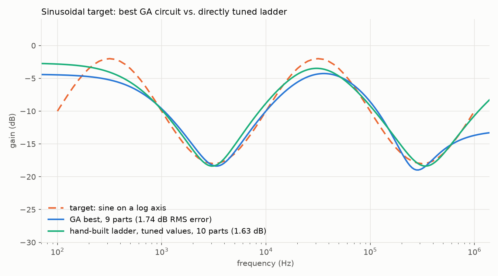

# Design Notes: GA-Based Analog Circuit Topology Synthesis

Status: v1 in progress. These notes record the design decisions and open questions.

## v1 scope and decisions

- **Flat GA, at most 10 components per circuit**, built from single parts only: R, C, L, diodes, NPN, PNP, NMOS, PMOS. All are enabled by default; an experiment can restrict them with `[mutation] kinds` (e.g. no inductors for on-chip designs).
- **Building blocks and a learned component library are deferred.** Once flat search works, the plan is to mine recurring subgraphs from good circuits into a library and use library blocks as components. The sections below that mention blocks describe that later stage.
- **Fitness is small-signal for now:** `.op` + `.ac`. Large-signal analysis (`.tran`, THD) comes later as an extra evaluation stage.
- **Both BJTs and MOSFETs**, using simple generic models (Gummel-Poon BJT, level-1 MOSFET) for the search. Detailed models are only for checking final circuits.
- **MOSFET bulk is tied to the rails** (NMOS to GND, PMOS to VDD) during netlist export. It isn't a pin the GA evolves.
- **The test circuit supplies VIN's DC level** (VDD/2 by default), so the GA doesn't spend components on input biasing.

## Code layout

```
src/acd/
├── circuit/      the circuit itself: plain data, no SPICE (devices, graph, validity, hashing, netlist)
├── sim/          ngspice shared-library wrapper behind a Simulator interface
├── evaluation/   test circuits, staged evaluation, metrics, targets, fitness, cache
├── operators/    mutations and seed population
├── search/       generic GA loop, selection, parallel evaluation
├── models/       generic SPICE device models
├── experiment.py config loading and run output
└── cli.py        command-line entry point
```

Which module may import which: `circuit/` imports nothing else from the project. `sim/` handles only netlist text. `evaluation/` is the only place where circuits and the simulator meet. `search/` knows nothing about circuits; `experiment.py` connects it to them.

## Goal

Use a genetic algorithm to evolve new circuit topologies, using crossover (such as subgraph swap) and mutation, that best meet a fitness metric. The first fitness target is a **frequency response the user supplies**, plus secondary goals such as **power consumption**.

**The main focus is nonlinear circuits (transistor-based).** Every candidate therefore has to be simulated with SPICE.

## Representation

A circuit is a **bipartite graph**: component nodes on one side, net nodes on the other.

- **Each edge is labeled with its pin role**: `R.p`/`R.n`, `C.p`/`C.n`, `Q.c`/`Q.b`/`Q.e`, `M.d`/`M.g`/`M.s`(/`M.b`). Pin order doesn't matter for R, L and C, but it does for transistors and diodes.
- **Pin count is fixed by component type.** Every operator must keep it true.
- **Port nets are locked:** `GND`, `VIN`, `VOUT` and `VDD` can never be deleted or merged away.
- **Every net needs at least 2 connections.** A net with only one is dangling.
- **Evolution starts from a seed circuit**: input source with its source resistance, load resistance and supply, plus an evolvable path between input and output. Starting from random graphs mostly produces circuits that can't be simulated.

## Genetic operators

### Mutations
- Insert a component in series (split a net).
- Insert a component in parallel (between two existing nets).
- Delete a component (merge or reconnect its nets).
- Change a component's type (R ↔ C ↔ L, NPN ↔ PNP, and so on), keeping its pin count.
- Move one pin to a different net.
- Change a value: a log-normal step, rounded to standard E-series values.
- **Building-block mutations (important for nonlinear circuits):** insert a whole common-emitter or common-source stage, current mirror, differential pair, emitter follower, and so on, as one unit. Most random transistor graphs aren't biased properly, and these mutations greatly increase the share of useful circuits.

### Crossover (subgraph swap)
1. Grow a connected region from a random component in parent A.
2. Find the region's boundary nets (k of them).
3. Find a region in parent B with the same k boundary nets.
4. Swap the regions, trying the possible boundary mappings (cheap for small k), and keep a valid result.

Plan: **start mutation-only**, add crossover afterwards, and measure whether it actually improves results. Swapping whole building blocks is where crossover should help most.

## Topology vs. component values

A good topology with poorly chosen component values scores badly and gets dropped before its values are tuned. Two fixes:
- **Inner sizing loop:** each new topology gets a short, budgeted value/sizing optimization (such as a few CMA-ES steps) before it is scored.
- **Speciation (NEAT-style):** new topologies only compete within their species for a few generations, so they have time to improve.

## Simulation

- **ngspice runs in the search loop**, loaded in-process as a shared library (`libngspice`, through PySpice or direct `ctypes`). This avoids the cost of starting a program and writing and parsing a `.raw` file for every evaluation.
  - One libngspice instance isn't safe to share across threads, so the plan is a **process pool where each worker loads its own copy**.
- **LTspice is for checking final candidates** and viewing their schematics, not for the search loop. It runs as a separate program for every simulation, which is too slow for the number of evaluations a GA needs.
- **Put the simulator behind one interface** so either backend can be swapped in.
- Install: `brew install libngspice` (the shared library; `brew install ngspice` adds the command-line program for debugging).

### Staged evaluation (stop early, keep it cheap)
1. **Graph checks (cost nothing).** Reject a circuit if it has:
   - floating nodes, meaning no DC path to ground
   - loops made only of voltage sources and inductors
   - a component with all its pins on one net
   - an output not connected to the input
   - a MOSFET gate or BJT base with no DC path (the matrix would be singular)
2. **`.op` (cheap).** Reject if it doesn't converge or if transistors are biased in the wrong operating region. **Power consumption comes from this step at no extra cost** (supply current × VDD).
3. **`.ac`, run only on circuits that pass stage 2.** Use a coarse frequency grid during the search and a fine one for final candidates.
4. **`.tran` + FFT, only if large-signal fitness is needed** (see the open question below).

### Robustness
- Convergence failures and hangs are **normal** for random nonlinear circuits. Give every run a timeout, set `gmin`/`rshunt`/iteration-limit options, and score failures as low fitness instead of crashing.
- **Cache results:** store fitness under a hash of the normalized netlist, because GAs evaluate duplicate circuits often.

### Budget (rough estimate, not measured)
- In-process `.op` + `.ac` on a circuit with about 20 devices: on the order of milliseconds.
- 40k topologies × about 30 sizing evaluations each is about 1M simulations, a few hours spread across all CPU cores. Workable, but only with staged evaluation and caching.

## Fitness

- **Frequency-response match:** magnitude error in dB on a log-spaced frequency grid, weighted by band. Phase is optional and needs care because of wrapping.
- **Spec masks as an alternative input**, for example "passband within ±1 dB up to 1 kHz, below −40 dB above 5 kHz". Masks are easier for users to write and easier for the GA to meet than an exact curve.
- **Objectives:**
  - response error
  - power consumption (from `.op`)
  - component count, to stop circuits growing without limit
  - component values that can actually be bought
  - later, possibly sensitivity or robustness
- **Use NSGA-II (for example `pymoo`) to get a Pareto front** instead of tuning weights for a weighted sum.

## Findings from the first runs

- **Simulation cost is small.** In-process ngspice runs `.op` + `.ac` (200 frequency points) on a 7-transistor circuit in under 1 ms, and a 100-circuit generation takes about 0.04 s on 11 worker processes. Separate `.op` and `.ac` calls aren't worth it: ngspice already skips `.ac` when the operating point fails.
- **Mutations mostly produce valid circuits:** about 79% pass the graph checks on the first try, 1.3 attempts on average. The most common rejection is a disconnected VIN or VOUT.
- **Both example targets are met.** The low-pass mask gives a 2-part RC in about 3 s. The 20 dB amplifier mask gives a 3-part PMOS amplifier in about 12 s.
- **Sinusoidal target (gain is a sine on a Bode plot, 2 periods over 100 Hz–1 MHz).** Usually the GA settles on a near-flat response at about 5 dB RMS error, barely better than a flat line (5.6 dB). One run in nine found a 9-part circuit at 1.74 dB. A hand-built 10-part ladder with its values tuned directly by differential evolution reaches 1.63 dB, so 10 parts are enough and the bottleneck is the search: a resonance only helps once its L, C and damping are all roughly right, and the GA changes one value at a time. The next step is the per-topology sizing loop plus speciation (plan item 2). Plots and both circuits: [`docs/results/`](docs/results/).

  
- **A sine in linear frequency (a comb filter) is out of reach** for 10 lumped parts: no progress beyond a flat line.
- **Crossover hasn't helped yet.** Amplifier target, 3 seeds each: every run meets the mask with or without crossover. Sine target, 3 seeds each: mean RMS error 4.9 dB with `crossover_rate = 0.3`, 3.8 dB without, 4.2 dB with settings that favor diversity (population 600, tournament size 2, twice as many value mutations). About half of crossover children are identical to a parent. The example configs leave crossover off until it shows a benefit, probably together with the sizing loop.
- **The GA exploits model weaknesses.** The amplifier biases itself through a PMOS conducting 4 pA, which works only because level-1 MOSFETs have no subthreshold current. The best sine circuit does the same (a PMOS at 5 pA). Next fix: require a minimum current (or current density) for a transistor to count as active in the bias score.

## Resolved: what "nonlinear" means for the fitness

**Small-signal first, large-signal later.** v1 measures behavior around a bias point with `.op` + `.ac`. Large-signal behavior (distortion/THD, clipping, oscillators) needs `.tran` + FFT, which is roughly 10–100× more expensive, and will be added as another evaluation stage with its own metrics.

## Plan

1. **Flat v1 (current):** circuit graph, netlist export, graph validity checks, ngspice wrapper, staged evaluation, mutation-only GA with a seed circuit, at most 10 components, result caching, spec-mask and curve targets.
2. **Better search:** an inner sizing loop for each topology, speciation, subgraph-swap crossover.
3. **Multi-objective:** NSGA-II over response error, power and component count.
4. **Component library:** mine recurring subgraphs into blocks and use blocks as components (see the block sections above).
5. **Output:** LTspice export of the best circuits for checking and schematic viewing.
